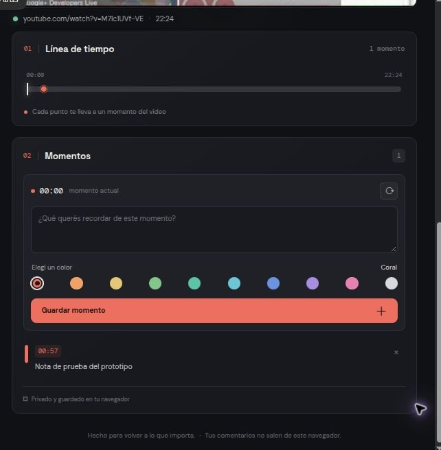
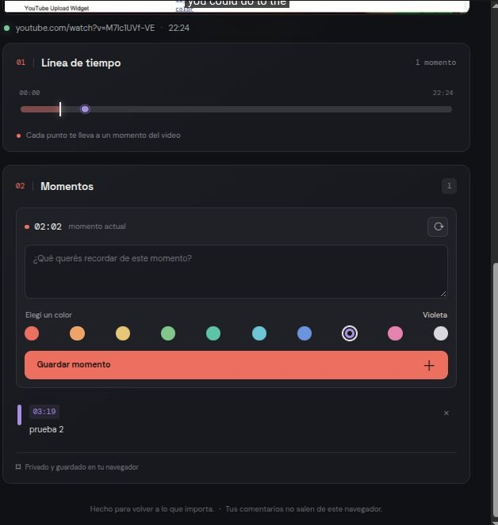

# YouTube Temporal Comments

**Guardá notas privadas en momentos concretos de un video de YouTube y encontralas desde una línea de tiempo propia.**

## Vista previa

Así se ven la línea temporal con marcadores de colores y las notas asociadas a cada momento:



Al seleccionar un marcador, la línea temporal permite volver a ese instante:



Este proyecto es un prototipo abierto para explorar una idea: convertir los comentarios personales de un video en un mapa visual de momentos. No es una extensión oficial de YouTube ni publica comentarios en YouTube.

## Estado

Prototipo funcional en desarrollo. La reproducción usa la YouTube IFrame Player API oficial. Los comentarios se guardan en el `localStorage` del navegador, organizados por ID de video.

## Funciones actuales

- Cargar videos desde enlaces de YouTube, `youtu.be`, Shorts y enlaces de inserción.
- Crear una nota con el momento actual y elegir entre 10 colores.
- Ver las notas en orden cronológico y como pequeños marcadores sobre una línea proporcional a la duración.
- Saltar al momento asociado desde la nota o su marcador.
- Recuperar los datos al volver a cargar el mismo video y borrar notas.
- Usar la interfaz adaptable en escritorio y pantallas pequeñas.

## Requisitos

- Python 3.10 o posterior.
- Flask 3.x.
- Conexión a Internet para cargar la API y reproducir videos de YouTube.

## Ejecutar en local

Desde la carpeta del proyecto, crea un entorno virtual para mantener Flask aislado de los paquetes globales de Python:

```bash
python3 -m venv .venv
source .venv/bin/activate
python -m pip install -r requirements.txt
python app.py
```

Luego abre <http://127.0.0.1:5000> en el navegador.

En algunas distribuciones de Linux, crear un entorno virtual requiere instalar el paquete de sistema `python3-venv`. El proyecto no necesita Node.js, una base de datos, cuentas ni un servicio propio en la nube.

## Privacidad y límites

- Las notas permanecen en el almacenamiento local de ese navegador y dispositivo. No se sincronizan ni se envían al servidor Flask.
- Borrar los datos del sitio o cambiar de navegador puede eliminar el acceso a las notas.
- La aplicación no descarga videos, no hace scraping y no accede a datos privados de YouTube.
- Algunos videos no permiten reproducción incrustada. En esos casos, el propietario del video o YouTube determina la disponibilidad.
- Este prototipo todavía no incluye exportación, sincronización, usuarios, comentarios públicos ni una aplicación móvil.

## Colaborar

¡Las contribuciones son bienvenidas! Puedes abrir un issue para proponer una mejora o informar un problema, o enviar un pull request. Para mantener el alcance claro, las mejoras de la mecánica principal y la accesibilidad son un buen punto de partida.

1. Haz un fork del repositorio.
2. Crea una rama para tu cambio.
3. Describe qué problema resuelve y cómo lo probaste.
4. Abre un pull request.

## Apoyar el proyecto

¿Te gustó el proyecto? Si quieres colaborar voluntariamente, puedes invitarme a un cafecito o mate:

- [Ko-fi](https://ko-fi.com/martinmartinezgarcia)
- [PayPal](https://www.paypal.com/paypalme/blufferedtwitch)
- [Internet satelital Starlink](https://starlink.com/?referral=RC-DF-5848974-78640-68&app_source=share&utm_source=chatgpt.com) — enlace de afiliado; puede ofrecerte el primer mes según las condiciones de Starlink.

## Tecnología

Python, Flask, HTML, CSS y JavaScript vanilla. Reproductor oficial mediante YouTube IFrame Player API; persistencia local mediante `localStorage`.

## Licencia

Este proyecto se distribuye bajo la licencia MIT. Consulta el archivo [LICENSE](LICENSE).
